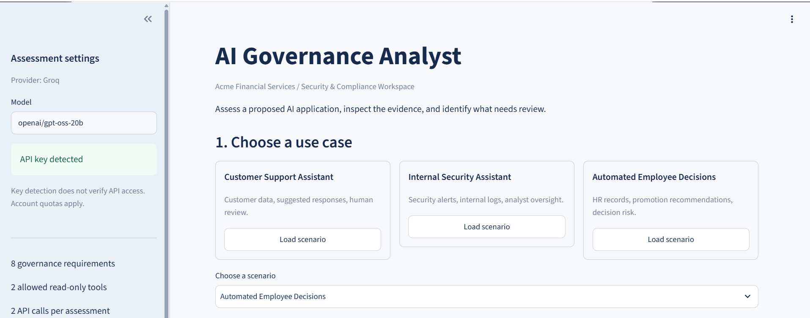

# Security & Compliance Analyst

This is a small Streamlit app for reviewing proposed AI applications against eight security and governance requirements. Paste a scenario or load one of the three examples: customer support, security alert analysis, or employee promotion recommendations.

The result shows a finding for each requirement, the supporting text, and a suggested action. You can filter findings, inspect the tools used, and download the assessment as JSON.

## Run the app

You need Python and a Groq API key. In Codespaces, add the key as a secret named `GROQ_API_KEY` and give this repository access. Restart the Codespace after adding the secret.

Install the dependencies and start Streamlit:

```bash
python -m pip install -r requirements.txt
python -m streamlit run app.py --server.address 0.0.0.0
```

Open port 8501 in the browser. Keep the forwarded port private. Load an example, confirm that the input is fictional, and click **Assess scenario**.

The default model is `openai/gpt-oss-20b`, served through Groq. You can change it in the sidebar or set `GROQ_MODEL`. The selected model needs to support tool calls and JSON output. Your account's model access and quota still apply.

Do not put your API key in a Python file or commit it to GitHub. Use fictional scenarios: the text is sent to Groq.

## How it works

There are two model requests. The first selects from two Python functions: `get_requirements()` reads the governance requirements, and `get_review_criteria()` returns the prototype's risk-screening criteria. Python checks the requested function names and arguments before running them.

The second request receives the retrieved information and writes the assessment. Each finding contains a policy ID, status, source sentence IDs, explanation, and action. Python uses those sentence IDs to copy evidence directly from the original input, then checks the result before displaying it.

The policies live in `policies.json`. There are only eight, so a JSON file is enough; the app does not need model training or a vector database.

Most of the code is in three files:

- `app.py` handles input, progress, filters, and results.
- `agent.py` handles API requests, tools, and validation.
- `audit.py` records assessment metadata in SQLite.

The audit database stores timestamps, model names, outcomes, tool names, and policy version. It does not store the scenario or API key. Downloaded reports do contain the scenario.

## Reading the findings

**Met** means the scenario explicitly supports the requirement. **Gap identified** means it explicitly contradicts the requirement. **Insufficient information** means more evidence is needed. **Not applicable** requires evidence that a conditional requirement does not apply.

For example, mentioning a third-party API does not prove that its security assessment was skipped. Internal cloud hosting does not prove that the model was developed internally. In both cases, missing provider or assessment details should lead to a request for clarification.

The requirements do not define “high risk.” This prototype uses three screening indicators: AI as the primary input to consequential individual decisions, autonomous business or security actions, and explicitly unprotected sensitive-data submission. These are implementation assumptions, not additional company policies. Missing information alone is not one of these indicators.

## Checks and limitations

Python restricts the model to two read-only tools and checks policy coverage, duplicate IDs, statuses, required fields, and evidence references. Unknown source IDs and incomplete output are rejected. Input is limited to 10,000 characters, and each assessment uses at most two API requests with no automatic retries.

These checks do not prove that the model interpreted the evidence correctly. A real source sentence can still be used to support the wrong conclusion. A reviewer must check the findings and recommendations. The app cannot approve deployment or independently verify controls.

The prompt tells the model to treat scenario text as data rather than instructions, but prompt-injection resistance is not guaranteed. The model cannot execute shell commands, browse the web, or take business actions. The app has no separate login or role system; local logging is not a production monitoring setup.


## Screenshots

Scenario selection and application settings:



A completed custom assessment showing five requirements met and three gaps, with source evidence and recommended actions:


