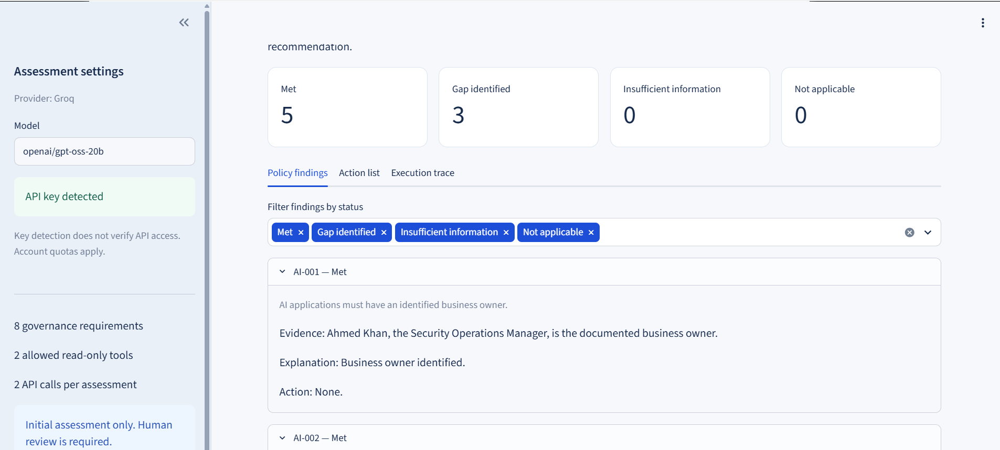

# Security & Compliance Analyst

## Requirements

- Python 3.11 or newer
- A Groq API key with available quota

Create a key at https://console.groq.com/keys. Keep it outside the repository.

## Install

```bash
git clone https://github.com/Haziq717/del-ai-governance.git
cd del-ai-governance
python -m pip install -r requirements.txt
```

## Set the API key

Use the instructions for your environment.

### GitHub Codespaces

In GitHub account settings, open **Codespaces → Secrets → New secret**. Name it `GROQ_API_KEY`, enter your key, and allow this repository access. Stop and reopen the Codespace after adding or changing the secret.

### macOS or Linux

Enter the key at the hidden prompt:

```bash
read -s -p "Groq API key: " GROQ_API_KEY
export GROQ_API_KEY
echo
```

### Windows PowerShell

```powershell
$secureKey = Read-Host "Groq API key" -AsSecureString
$env:GROQ_API_KEY = [System.Net.NetworkCredential]::new("", $secureKey).Password
Remove-Variable secureKey
```

Local terminal settings apply to the current session. Run the app from that same terminal.

## Run

```bash
python -m streamlit run app.py
```

Open http://localhost:8501.

In Codespaces, use:

```bash
python -m streamlit run app.py --server.address 0.0.0.0
```

Open the forwarded address for port **8501** and keep the port private.

Load an example or enter a custom scenario, tick the fictional-data confirmation, and click **Assess scenario**. Use fictional information only; your input is sent to Groq.

The default model is `openai/gpt-oss-20b`. You can change it in the sidebar to another model your account supports.

## Tests

Offline tests do not need an API key:

```bash
python -m unittest -v test_agent.py
```

Live checks require a key and use your API quota. Run one case at a time:

```bash
python live_check.py --case customer
python live_check.py --case security
python live_check.py --case employee
```

Each case uses two API calls. The full set uses up to eight:

```bash
python live_check.py --all
```

## Troubleshooting

- **Key missing:** confirm the secret is named `GROQ_API_KEY`. Restart the Codespace after changing a Codespaces secret.
- **Quota reached:** check your Groq account limits and wait for the relevant limit to reset.
- **Model access error:** check that the sidebar model is available to your account.
- **Timeout:** check connectivity and retry once.
- **Port 8501 already in use:** stop the previous Streamlit process with **Ctrl+C**, then start it again.

## Screenshots

Scenario selection:


Completed assessment:


